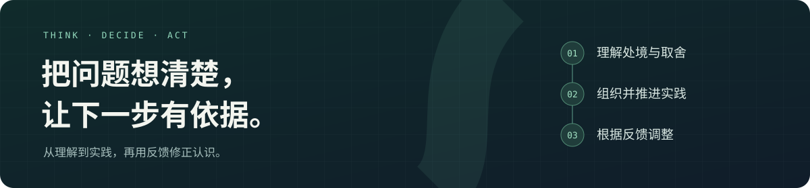

<h1 align="center">知行问题分析</h1>

<p align="center"><strong>面向生活与项目的 AI 思考、决策与行动伙伴</strong></p>



<p align="center">
  <code>中文 AI Skill</code> · <code>按需深入</code> · <code>阶段 / 周 / 日规划</code> · <code>记录与续接</code>
</p>

<p align="center">
  <a href="#适用场景">适用场景</a> ·
  <a href="#快速开始">快速开始</a> ·
  <a href="#可以这样开始">使用示例</a> ·
  <a href="#规划到哪一步由你决定">规划方式</a> ·
  <a href="#方法与案例">方法与案例</a>
</p>

---

**知行问题分析（`zhixing-analysis`）是一套安装到 AI 助手中的分析与协作技能。** 当你有生活疑虑、面临重要选择，或需要推进一个长期项目时，它帮助你整理问题、比较取舍、形成计划，再用实际反馈调整判断。

小问题直接讲清楚；复杂问题先给有依据的初步判断或路线，再追问关键缺口。你可以只聊清一个困惑，也可以一起推进数周、数月的事情。

## 适用场景

| 当你遇到…… | 它会帮助你…… |
|---|---|
| **想不清楚**：事情很多，说不清自己卡在哪里 | 整理处境、感受和目标，区分事实、解释与未知 |
| **难以取舍**：几个选项各有吸引力，也各有代价 | 比较约束、收益和代价，形成有条件的推荐，由你决定价值排序 |
| **推进不动**：目标很大，不知道先做什么 | 连接阶段成果、任务依赖和可用资源，形成适合当前精力的安排 |
| **需要调整**：投入不少，结果却没有改善 | 对照预期与证据，判断继续、调整、停止，或再观察 |

学习与职业准备、生活安排、团队项目、产品试点，都可以从这里开始。对于暂时没有明确目标的生活疑虑，先理解清楚、辨认自己的需要，也是一种有效结果。

## 快速开始

### 1. 安装到助手的 skills 目录

以 Windows 用户级 `.agents/skills` 目录为例：

```powershell
git clone https://github.com/Ctperfect/zhixing-analysis.git "$env:USERPROFILE\.agents\skills\zhixing-analysis"
```

其他环境可以将本仓库放入所用助手支持的 skills 目录，保留文件夹名 `zhixing-analysis`。具体发现路径和加载方式以宿主助手为准；技能入口是 [`SKILL.md`](SKILL.md)。

<details>
<summary>已经通过 Git 安装，如何更新？</summary>

确认安装目录没有需要保留的本地修改后，在 Windows 示例目录中更新：

```powershell
git -C "$env:USERPROFILE\.agents\skills\zhixing-analysis" pull --ff-only
```

这个命令适用于通过 `git clone` 安装的副本。通过其他工具安装时，使用对应工具的更新方式。

</details>

### 2. 带着真实问题开始

让助手加载技能后，可以直接这样说：

```text
使用 $zhixing-analysis 帮我梳理这个问题：
最近要做的事情很多，我不知道从哪里开始。
先帮我看清问题，再讨论下一步。
```

说明你的处境，以及这次希望得到什么帮助即可。能从现有材料查到的信息先查，需要你作出的取舍再问。

## 可以这样开始

<details open>
<summary><strong>聊清一个困惑</strong> · 先理解，再决定是否行动</summary>

```text
使用 $zhixing-analysis：为什么资料越收藏，越不知道怎么开始？
先简单解释，这轮只聊，不用给长期计划。
```

</details>

<details>
<summary><strong>讨论一个选择</strong> · 比较代价，保留自己的优先级</summary>

```text
使用 $zhixing-analysis 和我讨论这两个选择。
帮我检查关键前提，比较现实约束和代价，指出哪些取舍需要我决定。
```

</details>

<details>
<summary><strong>推进一个项目</strong> · 从整体路线走到近期任务</summary>

```text
使用 $zhixing-analysis 规划这个项目。
先给整体路线，再把未来七天细到每天，结合我的可用时间安排任务和检查办法。
```

</details>

<details>
<summary><strong>继续之前的计划</strong> · 条件变化后调整安排</summary>

```text
使用 $zhixing-analysis 继续这个项目：这周可用时间减少了。
请读取已有记录，检查影响，调整相关任务、顺序和时间安排。
```

</details>

## 规划到哪一步，由你决定

| 规划粒度 | 你会看到什么 | 适合怎样的请求 |
|---|---|---|
| **阶段** | 整体路线、阶段成果、关键依赖与检查点 | “先帮我看清全局。” |
| **每周** | 每周优先成果、任务、资源和复盘节点 | “把未来四周安排到每周。” |
| **每日** | 每天做什么、预计多久、产出什么、怎样检查 | “先排未来七天的每日任务。” |

**粒度和时间范围分别确定。** 可以先看整个项目的阶段路线，只把近期一周细到每天。需要详细规划但偏好尚不明确时，AI 会询问；你已经说明的要求会直接沿用。

计划会考虑实际时间、精力、任务依赖和估算的不确定性。资源减少、任务受阻或新证据出现后，调整受影响的部分。长期项目中的一个小问题，也可以用一段简短回答讲清楚。

## 让讨论能够继续

复杂讨论和长期项目会按需保存到工作区，优先沿用同主题记录；没有现成结构时，使用 `docs/zhixing/<主题>.md`。

记录会分清 **你已确认的决定、AI 的建议、待核实的解释**，并保留当前路线、进展证据、阻塞和下一步，方便后续读取并接着推进。

你可以指定保存位置，也可以说“这轮只聊”或“只保存最终总结”。没有文件工具时，助手会提供可复制的摘要，并说明实际保存状态。具体约定见 [记录与续接](references/records.md)。

## 方法与案例

这套技能结合第一性原理、机制解释与最小验证，用六个可回返的环节组织深入分析：

> 定题与取舍 → 检查事实与前提 → 建立机制解释 → 选择路径与最小验证 → 组织并推进实践 → 根据反馈更新

按本轮需要使用相关环节。理解、决策和实践各有自己的完成标准，方法会随实际反馈继续修正。

| 想进一步了解…… | 从这里阅读 |
|---|---|
| 概念、分析路线与方法来源 | [完整方法说明](references/methodology.md) |
| 阶段拆解、依赖、容量、每日计划与重规划 | [从目标到可执行计划](references/planning.md) |
| 怎样分轮讨论、检查前提和追问 | [深度讨论](references/dialogue.md) |
| 职业准备、项目推进、人生取舍与边界情境 | [职业案例](references/cases/career.md) · [项目案例](references/cases/project.md) · [人生取舍](references/cases/life.md) · [理解与复盘](references/cases/understanding-review.md) |

案例均为通用或假设示范，使用时以当前用户的目标、资源和证据为准。

<details>
<summary>查看技能文件结构</summary>

```text
zhixing-analysis/
├── SKILL.md                  入口、核心原则与按需路由
├── agents/openai.yaml        展示信息
├── references/
│   ├── methodology.md        完整方法说明
│   ├── planning.md           规划与重规划
│   ├── dialogue.md           分轮讨论
│   ├── records.md            记录与续接
│   └── cases/                情境示例
└── assets/readme-banner.svg  README 封面
```

日常使用只读取相关材料，封面素材用于仓库展示。

</details>
